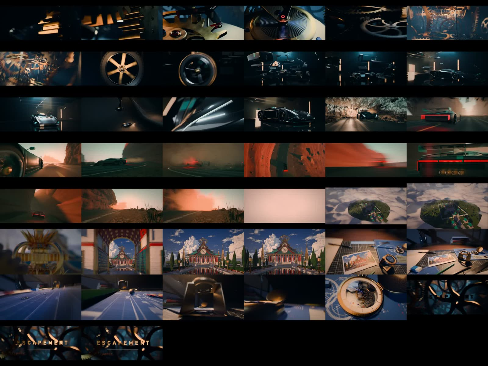
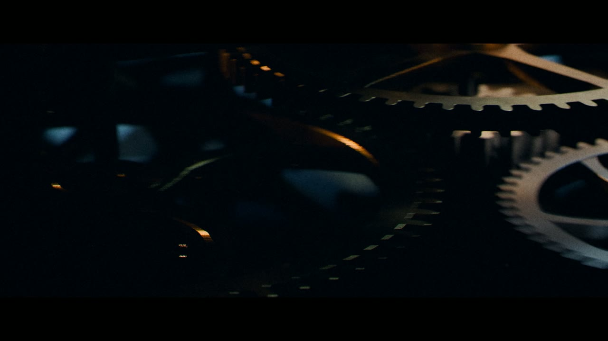
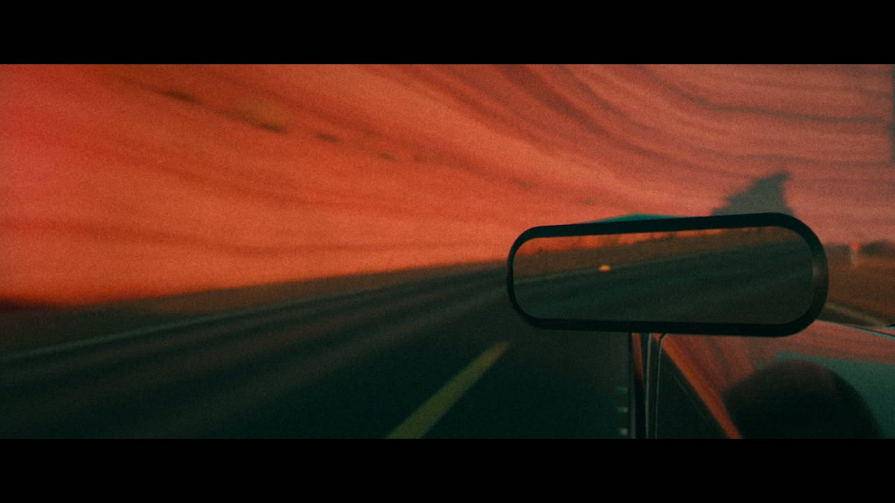
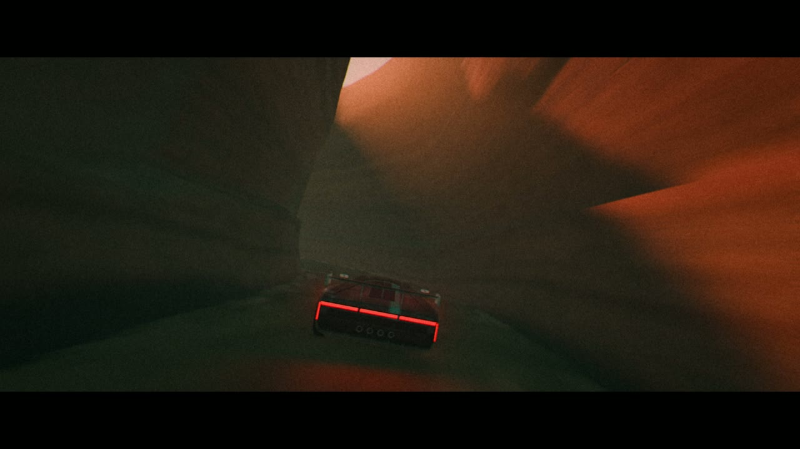
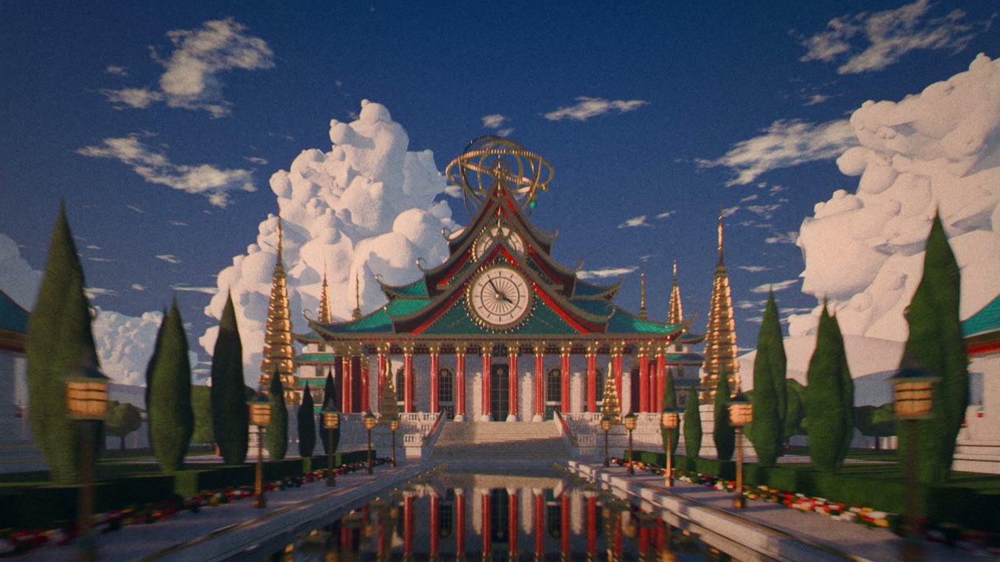
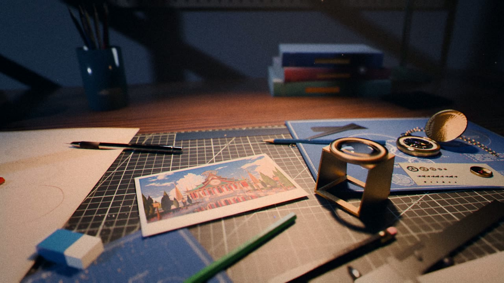
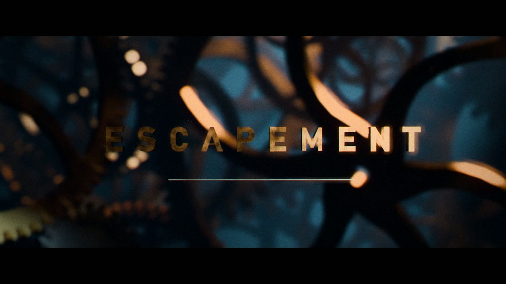

# ESCAPEMENT

A 36-second cinematic short film made by **Claude Code (Opus 5.5)** driving **Blender 5.2** headless from Python, on a laptop with an integrated GPU (AMD Radeon 780M). One prompt, then a few rounds of feedback.

**Watch it:** [ESCAPEMENT.mp4 (1080p master)](https://github.com/Leonxlnx/escapement/releases/latest) · the release also has a smaller copy for phones.



## The film

Macro clockwork lit out of the dark → a 6-spoke gear match-cuts into a car's wheel → the hypercar assembles itself in a dark studio, parts slamming on the beat → the studio breaks apart into a dusk canyon → the drive (tracking shot, mirror, drift, top-down drone, the car driving over the camera, a slot-canyon chase) → the dust turns into clouds → a clockwork temple → the last frame match-cuts to the same image as a printed photo on a desk → a low run across the desk → a dive into a pocket watch → title.

| | | |
|---|---|---|
|  |  |  |
|  |  |  |

## How it was made

- **Every 3D object, material, light and camera move is Python.** No 3D models or image textures were downloaded. Gears, the car, the canyon, the temple and the desk props are all generated by the scripts in `lib/` and `shots/`.
- **One agent per act.** Five builder agents worked on the five acts in parallel, then a director agent critiqued each act and a second pass applied the fixes (`notes/act*.md` are their iteration logs). The brief they worked from is [`BRIEF.md`](BRIEF.md); the shot table is [`shotlist.json`](shotlist.json).
- **One render at a time.** Every Blender run goes through `tools/rb.py`, which holds a global GPU lock (`tools/gpu_guard.py`). Letting several EEVEE renders share the iGPU bluescreened the laptop once (`0x119 VIDEO_SCHEDULER_INTERNAL_ERROR`), so the lock is never bypassed.
- **Measured, not eyeballed.** `tools/exposure_check.py` scores every still for clipped highlights, lifted blacks and dull colour, and `common.compositor()` rolls highlights off before they reach white.
- **Edit, grade and mix are code too.** `tools/edit.py` (numpy + ffmpeg) conforms the shots, does the transitions (cuts, match cuts, a dust-to-cloud luma dissolve), the grade, halation, grain and letterbox. `tools/mix.py` mixes music and sound effects from `edit/cues.json`, cut to the music's 120 BPM grid (12 frames per beat).

## Repo layout

```
BRIEF.md          production bible the agents worked from
shotlist.json     every shot: id, script, cut length, handles
lib/              shared toolkit (common.py) + per-act generators (car, canyon, temple, desk, clouds...)
shots/            one script per act; `--shot <ID>` builds the scene and renders that shot
tools/            render runner + GPU lock, render queue, edit/grade, mixer, cue + EDL generators, QC
edit/             the final edit decision list, trims and sound cue sheet
audio/            manifest of every sound (source URL, license, author) + music beat analysis
notes/            the agents' iteration logs per act
docs/             stills
```

## Reproducing it

Requirements: Windows, Blender 5.2, ffmpeg on PATH. Everything runs with Blender's bundled Python (it has numpy).

1. Set `BLENDER` to your `blender.exe`.
2. Download the sounds listed in `audio/manifest.json` (Mixkit and Freesound CC0, links included) into `audio/sfx/` and `audio/music/` with the file names given there. The audio files themselves aren't in this repo because the Mixkit license doesn't allow redistributing them as standalone files.
3. Render a test still: `python tools/rb.py shots/act1_gears.py -- --shot 1A --stills 30 --pct 50`
4. Render the shots: `python tools/render_queue.py` (one Blender process at a time; it can take many hours on an iGPU).
5. Build the edit and mix: `python tools/make_edl.py`, `python tools/make_cues.py`, then `python tools/assemble.py`.

Honest caveats:

- `shots/act4_temple.py` contains a later cloud rework that turned out too heavy to render on this laptop (it froze the GPU). The released film uses the earlier cloud deck for the temple reveal, and the cloud-emergence shot (4A) and two temple close-ups (4D, 4E) were cut from the edit.
- Fast-motion shots were rendered at 83% resolution and 16 samples to fit the render time, then upscaled.
- Paths and timings were tuned for one specific laptop. Expect to adjust samples and volumetric settings for yours.

## Credits

- Music: "Epical Drums 02" by Grigoriy Nuzhny, [Mixkit](https://mixkit.co/free-stock-music/) (Mixkit Stock Music Free License).
- Sound effects: [Mixkit](https://mixkit.co/free-sound-effects/) (Mixkit Sound Effects Free License) and [Freesound](https://freesound.org) (CC0). Every file, its source and license is listed in `audio/manifest.json`.
- Made with Claude Code (Claude Opus 5.5) and Blender.

## License

Code: MIT, see [LICENSE](LICENSE). The music and sound effects keep their own licenses listed above.
